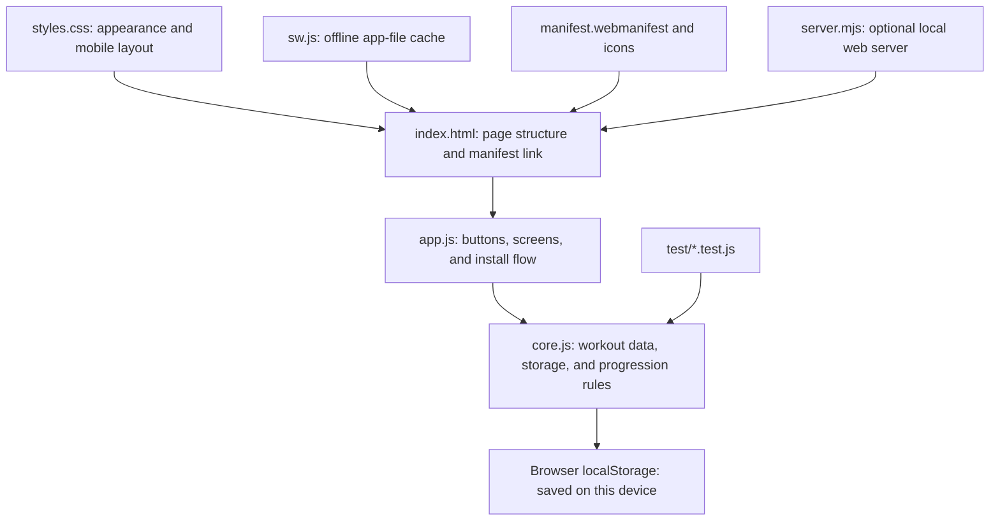

# Learn how the workout app is built

This project is a small web app made from HTML, CSS, and plain JavaScript. There is no framework, database server, account, or paid API. The browser runs the app and keeps its data on the device.

## The layers

| File | What it does | A good first change |
|---|---|---|
| `index.html` | Describes the page: navigation, buttons, dialogs, and empty places for content. | Change a page heading or button label. |
| `styles.css` | Controls color, spacing, type, cards, and responsive layouts. | Change the colors in the `:root` section near the top. |
| `app.js` | Connects the page to the data. It responds to clicks and typing, draws the workout, progress, exercises, and history screens. | Search for `renderWorkout`, `renderHistory`, or `renderExercises`. |
| `core.js` | Holds the exercise and starter-plan data, input shape checks, local saving/loading, previous-session lookup, and progression math. It also exposes these functions to both the browser app and tests. | Change the progression rule and its test together. |
| `test/` | Checks the shared core rules, including saving/loading and progression. | Add a case for a rule you changed. |
| `server.mjs` | Serves the files locally when you want to use a phone on the same Wi-Fi. | Usually you will not need to change it. |
| `manifest.webmanifest` | Gives Android the app name, launch behavior, colors, and icon. | Change the app name or theme color here. |
| `icons/app-icon.svg` | The scalable source icon used by browsers and as the favicon. | Change the shapes or colors in the SVG. |
| `icons/app-icon-192.png`, `icons/app-icon-512.png` | Raster app icons at common Android install sizes. The 512px icon is also marked maskable so Android can crop it to different launcher shapes. | Edit the SVG and run the generator to make new PNGs. |
| `tools/generate-icons.ps1` | Draws the two PNG sizes from simple vector strokes using Windows' built-in drawing library. | If you change the design, update the SVG and the stroke coordinates here, then run it. |
| `sw.js` | Caches the app shell so it can open offline after the first online visit. | Add a new file here if the app starts needing it offline. |
| `README.md` | Launch and backup instructions. | Update it if the launch steps change. |

The page HTML is loaded first. The browser then loads `core.js`, followed by `app.js`. `app.js` asks the core for data, places that data into the page, and attaches click/input handlers. When the data changes, the app saves it and refreshes the relevant screen. On a hosted secure site, `app.js` registers `sw.js`, which fetches fresh app files while online and uses its cache if the network is unavailable.

## What happens when you start a workout

1. `app.js` reads the selected plan and looks up the most recent logged performance for each exercise.
2. `core.js` applies the progression rule and returns a suggested target.
3. `app.js` creates an in-progress session and shows weight, reps, and RIR fields.
4. Each edit is saved to browser `localStorage`, so reloading the page can restore the active session.
5. **Finish and save** moves the session into workout history. The progress charts and previous-performance display use those saved records.

The starter routines are *plans*, not pretend workout history. Charts stay empty until you log a real session.

## Changes you can make

### Change the look

Open `styles.css`. The first `:root` block holds the main colors, for example `--green`, `--deep`, and `--canvas`. Change a value and reload `index.html`. More specific rules lower in the file control individual cards and screen widths.

### Add or change exercises

For your own account, the easiest way is the **Exercises** screen in the app: add an exercise, choose its muscle group, and set its rep range. To change the starter catalog for a fresh browser profile, edit the `defaultExercises` list in `core.js`. Each entry has a name, muscle group, minimum reps, and maximum reps.

### Change the weekly plan

Use **Edit plan** in the app to change your saved routines. For the initial Monday, Wednesday, and Friday examples that appear in a fresh browser profile, edit `createInitialData()` in `core.js`. Plans store exercise IDs, which link a routine to the exercise catalog.

### Change progression

The `recommendNext()` function in `core.js` owns the rule. At present, it adds 2.5 kg only when every set reaches the top of the rep range with at least 2 RIR. Otherwise it holds the weight and suggests one more rep per set, capped at the range maximum. The tests in `test/progression.test.js` show the expected behavior for both cases. Change the function and tests together, then run the tests.

### Change what the charts measure

`estimatedOneRepMax()` in `core.js` uses `weight × (1 + reps / 30)`. `renderProgress()` in `app.js` builds weekly volume by adding `weight × reps` for logged sets. You can change either calculation, but update or add tests for calculations that belong in `core.js`.

## Saving and moving your data

The app stores one JSON object under the `my-muscle-progress-v1` key in this browser's `localStorage`. That includes plans, custom exercises, saved sessions, and an in-progress workout. It is local to the current browser and origin; it does not automatically sync to another device.

Use **Export data** to download a JSON backup. **Import** replaces the data in the browser where you import it, so export the current data first if you might need it. This is also how to move data between your PC and phone.

## Install on Android

The PWA needs to be hosted on an HTTPS address before Android Chrome can use its service worker and install flow. `file://` is only for local development, and the included Wi-Fi server is plain HTTP. Upload the static app files to an HTTPS host, open the site in Chrome on the phone, and use the page's **Install app** button if Chrome offers it. You can also use Chrome's menu and choose **Install app** or **Add to Home screen**. The manifest describes the installed app; the service worker makes the app files available offline after they have been cached. The manifest includes 192px and 512px PNG icons, which are recommended for Chromium installation. [Chrome installability guidance](https://developer.chrome.com/docs/lighthouse/pwa/installable-manifest/)

The service worker uses a network-first strategy so the hosted app can pick up file updates when the phone is online. If you change that strategy to serve from cache first, update the cache version in `sw.js` when you want to replace previously cached files.

## Run and test

- On Windows, double-click `index.html`; the app works without installing Node.js.
- To test on a phone, publish the static files to an HTTPS host. `npm run start:network` is useful for local HTTP testing on Wi-Fi, but it is not enough for the service worker/PWA install flow. See `README.md` for details.
- To run the tests, install Node.js and run `npm test` in this folder.

When learning, make one small change at a time, reload the page, and observe what changed. For progression edits, run the tests after each change.

## Learning while developing LiftLab

The project is being developed as a sequence of small milestones. Each feature is a chance to understand how the pieces of an app work together, not just where code is written.

For each completed task, add a short note here covering:

1. **The app concept:** for example, browser storage, data migration, filtering, accessible dialogs, or service-worker caching.
2. **The user-visible change and decision:** what problem it solves and why this approach was chosen.
3. **The components involved:** which page structure, styles, event handlers, shared logic, saved data, tests, or PWA files participate.
4. **How it was checked:** automated test results and any manual browser or phone checks, including things not verified.

Keep explanations plain-language and useful to someone learning app development. Record meaningful alternatives or tradeoffs, not every code detail. If the intended scope changes, explain why in `PLAN.md` and record the verified status separately in `PROGRESS.md`.

## Project decision records

These documents have distinct jobs:

- `PLAN.md` describes the intended scope, milestones, dependencies, and acceptance criteria.
- `PROGRESS.md` records what has actually been completed and verified, known issues, and the next action.
- `AGENTS.md` carries working instructions forward between sessions.
- This guide explains the architecture and the reasoning behind decisions as the app evolves.

Current product decisions include keeping workout data on the device, adding separate local profiles before expanding exercise metadata, using a curated exercise catalog with combined search and filters, and keeping demonstration media optional. The user will review the interface iteratively, one focused change at a time. Evidence-based training suggestions remain an optional future research step; no AI provider or API has been selected.

The near-term goal is personal local use on the user's phone. LiftLab currently uses PWA technology: GitHub Pages provides the HTTPS address required for installation, and the browser installs the app shell and caches its files. The hosted page is the current delivery path; phone installation and standalone use are what we should validate. The long-term goal is an Android app other people can download. Whether that means a packaged PWA or native/hybrid app, and whether it is distributed through an app store or direct download, is a later product and architecture decision.

## How the roadmap grows the app

The current app already has the main web-app layers: HTML structure, CSS presentation, JavaScript interactions, shared workout logic, browser storage, tests, and PWA packaging. Planned features will add to those layers:

- **Profiles and migration** teach how a saved-data format can evolve while preserving existing user records.
- **Exercise tags and filters** show how structured content supports search and discovery.
- **Coaching details and optional media** connect content design, accessible UI, and loading assets efficiently.
- **Progress insights** turn saved workout records into calculations and charts that need clear definitions and tests.
- **Collaborative UI iterations** connect user feedback to design decisions, implementation, and visual verification.
- **Optional training suggestions** require a separate evidence and privacy review before any service or AI integration is chosen.

Use the milestone learning notes to add concrete examples after the relevant work is implemented and verified. Do not describe planned behavior as if it already exists.

### First debugging lesson: classic-script scope

`core.js` declares a top-level `STORAGE_KEY`, and `app.js` reads the same name from the shared core object. When both files are loaded as classic scripts, top-level `const` declarations share a page-wide lexical scope and cannot redeclare the same name. The app's immediately invoked function expression (IIFE) gives `app.js` its own local scope and prevents that parse error. Removing the wrapper reproduced the browser error `Identifier 'STORAGE_KEY' has already been declared`, so it was restored.

The manifest warning seen when opening `index.html` through `file://` is a separate browser security limitation: local files have an opaque `null` origin, so the browser may block fetching the manifest. Use `npm.cmd start` and open `http://localhost:4173` to check the manifest over HTTP. After the wrapper restoration, JavaScript syntax checks and all seven core tests passed; the user also confirmed that the localhost app worked.

### Run LiftLab through localhost

There are two ways to open the app while developing:

- Double-click `index.html` to open the page directly from disk (`file://`). This is quick for basic layout and interaction checks, but browsers restrict some web features on file pages. In particular, a manifest or service worker may not load as it would on a website.
- Run `npm.cmd start` in PowerShell from the project folder, then open `http://localhost:4173` in the browser. This starts the small Node.js web server in `server.mjs`. It sends the project files to your browser over local HTTP, the same kind of connection used by a website, without publishing them to the internet.

`localhost` is a special name for the same computer you are using. The browser requests the app from a server running on your own computer, and port `4173` identifies LiftLab's local server. Other people cannot reach this address as a public website. The server keeps running in the terminal until you stop it with **Ctrl+C**; closing the terminal also stops it.

`npm` is Node.js's command-line tool for running project scripts. In this project, `package.json` defines `start` as `node server.mjs`, so `npm.cmd start` is a convenient way to launch that server. On this Windows setup, use `npm.cmd` in PowerShell because the `npm` PowerShell script can be blocked by the machine's script execution policy. `npm.cmd test` similarly runs the test script.

Localhost is treated as a secure development origin by modern browsers, so it can support development features such as the service worker that are unavailable to a `file://` page. It is still not the same as the hosted HTTPS URL used for installing the PWA on your phone. For phone access on the same Wi-Fi, the project also has `npm.cmd run start:network`; that shares the local server on the network using plain HTTP, which is useful for testing screens but does not provide the HTTPS secure origin required for Android PWA installation.

The user has manually added and completed two workout sessions and reported that both worked well. This is a useful real-use check that entering and saving sessions works. Automated tests also cover draft restoration and session edge cases, because a manual success does not cover every data state.

The user also manually tested draft recovery: they started a workout, closed the app before finishing, then reopened the same localhost address and found the workout still in progress. Starting a workout saves its draft in LocalStorage, so reopening the same browser origin restores it. The browser keeps localhost, `file://`, and the hosted PWA's data separately.

The user then finished a valid session and confirmed it appeared in history. They also left all sets empty and confirmed **Finish and save** showed the validation message asking for at least one rep and weight instead of saving. Together with draft recovery, these checks verify the main workout lifecycle in the browser: start, save progress, reopen, finish a valid session, block an empty session, and discard a draft.

### Testable session completion

The workout screen collects set values, but the shared `core.js` now owns the final decision about which values become a saved history record. `finalizeSessionDraft()` rejects a draft with no exercises or no complete, valid sets. It converts logged weight, reps, and RIR values to numbers, excludes incomplete or invalid weight/rep sets, and defaults invalid RIR values to zero. `app.js` calls this helper when the user presses **Finish and save**, then clears the active draft only after it receives a completed record.

Keeping this rule in the browser-safe core means Node tests can exercise the same decision the app uses without simulating every button and page element. Tests cover saved draft restoration and simulated set edits, additions, and removal; history preservation when routine/exercise details change; valid session finalization; invalid or empty session rejection; and leaving the active draft unchanged while preparing a saved record. All 11 tests passed at the time of that task, and the user manually confirmed draft recovery, valid saving to history, and empty-session blocking in the browser.

### Versioned profile data and migration

The current saved object is version 1: exercises, routines, sessions, and an optional active workout sit at the top level. To support separate local users, version 2 groups those same fields inside each profile and records which profile is active. The migration names the existing user's profile **Personal** and gives it the stable ID `profile-default`.

`migrateToProfileDatabase()` is a pure conversion helper: given valid version 1 data, it returns the version 2 envelope and leaves the input untouched. `validateProfileDatabase()` checks the envelope and its profiles. The app now runs this migration when it loads existing data and stores the converted record. Every profile owns its exercise list, plans, saved sessions, and active draft. Switching profiles saves the current draft first. A new profile gets a separate copy of the starter exercises and plans, with no history or active workout.

Export includes the entire profile database. Import validates the selected file before asking to replace local data; it supports both old flat version 1 backups and version 2 backups with multiple profiles. Support for all-profile backups was brought into the profile integration task so a user cannot create profiles that are omitted by export. Tests cover old-data migration, profile data isolation, fresh profile defaults, and backup conversion/preservation. The user manually confirmed profile creation, export/import, persistence after reload, and profile separation. Milestone 2 is complete; the next section explains how the exercise catalog was added without breaking profile data.

### Exercise catalog data and source choices

The exercise list now lives in `exercise-catalog.js`, loaded before `core.js`. Keeping catalog data separate makes the list easier to audit and extend without mixing it into workout calculations. The 30 existing `base-*` identifiers remain unchanged because routines and saved workout entries refer to those IDs. The curated catalog now has 91 strength exercises; new items use descriptive `lib-*` identifiers. The library now displays its count for the active profile, including any custom exercises, so a selected filter can be distinguished from the full list.

Each built-in entry has one or more `primaryMuscles`, optional `secondaryMuscles`, normalized `equipment` tags, a `category`, and `minReps`/`maxReps`. The existing `group` remains for current screens. The library can filter by muscle and equipment at the same time, and its text search also checks those tags. On load and backup import, `syncBuiltInExerciseCatalog()` adds newly shipped entries to every local profile and fills missing tags on older records. It keeps the existing names, rep ranges, custom exercises, plan IDs, workout records, and drafts. A test checks that this sync is safe to repeat and that it does not modify its input object.

For source research, LiftLab reviewed `smyrdev/exercises-dataset`, a 1,324-record MIT-licensed dataset with structured muscles and equipment. LiftLab takes a compact set rather than copying every variant into each profile's LocalStorage record. Its data has separate image/video rights, so no media was included. Exercise instructions are also deferred to their planned coaching-detail task. Rep ranges are LiftLab's initial logging targets, not claims from the source or scientific prescriptions. Source details and license text are in `EXERCISE_CATALOG_SOURCES.md` and `EXERCISE_CATALOG_LICENSE.txt`. Tests validate the IDs, names, tags, and rep ranges; the user still needs to check the expanded catalog and existing routine screens in the browser.

### Exercise library filters and first details view

The library now builds filter options from the saved exercise data rather than hard-coding a short list. The muscle filter checks both primary and secondary muscle tags; the equipment filter matches normalized equipment tags. They can be used together, and text search also checks tags. The Add exercise picker uses the same profile-derived filter options, so a routine or active workout can be narrowed in place. It reports the number currently available after excluding exercises already in the plan or session. On startup, the catalog sync appends the 61 new built-ins to the original 30, so the expected starter count is 91 before custom exercises.

The Details action opens a native HTML dialog so it works without another route or network service. It displays muscles, equipment, rep range, exercise setup, movement instructions, and a “Watch for” cue. The same dialog is available from the exercise library, planned workout list, routine editor, and active workout. The written cues live in `exercise-guides.js`, separate from page rendering, and cover all 91 built-in entries through curated movement-family rules. A Node test checks each built-in exercise resolves to a guide and checks a safe fallback for user-created exercises. English instructions in the MIT-licensed source dataset were reviewed and condensed as a reference; the full dataset and its media are not embedded. These are general technique prompts rather than individualized professional advice. The newly added entry points still need a manual check on desktop and phone.

A dropdown only stores the user's selection; the page must also listen for its change event and redraw the results. During manual testing, the Add exercise picker exposed both filters but no event handlers had been attached, so selecting a value left the old list on screen. Wiring each dropdown's change event to the picker renderer fixed the interaction. This is why a passing data-level test is not enough to verify interactive UI behavior.
