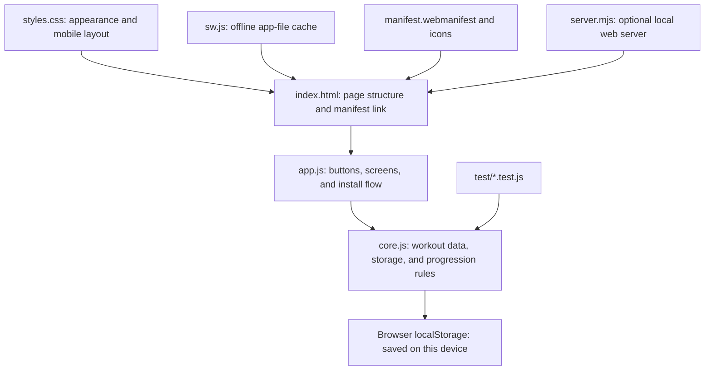

# Learn how the workout app is built

This project is a small web app made from HTML, CSS, and plain JavaScript. There is no framework, database server, account, or paid API. The browser runs the app and keeps its data on the device.

## The layers

| File | What it does | A good first change |
|---|---|---|
| `index.html` | Describes the page: navigation, buttons, dialogs, and empty places for content. | Change a page heading or button label. |
| `styles.css` | Controls color, spacing, type, cards, and responsive layouts. | Change the colors in the `:root` section near the top. |
| `app.js` | Connects the page to the data. It responds to clicks and typing, draws the workout, progress, exercises, and history screens. | Search for `renderWorkout`, `renderHistory`, or `renderExercises`. |
| `core.js` | Holds the exercise and starter-plan data, input shape checks, local saving/loading, previous-session lookup, and progression math. It also exposes these functions to both the browser app and tests. | Change the progression rule and its test together. |
| `test/` | Checks the shared core rules, including saving/loading and progression. | Add a case for a rule you changed. |
| `server.mjs` | Serves the files locally when you want to use a phone on the same Wi-Fi. | Usually you will not need to change it. |
| `manifest.webmanifest` | Gives Android the app name, launch behavior, colors, and icon. | Change the app name or theme color here. |
| `icons/app-icon.svg` | The scalable source icon used by browsers and as the favicon. | Change the shapes or colors in the SVG. |
| `icons/app-icon-192.png`, `icons/app-icon-512.png` | Raster app icons at common Android install sizes. The 512px icon is also marked maskable so Android can crop it to different launcher shapes. | Edit the SVG and run the generator to make new PNGs. |
| `tools/generate-icons.ps1` | Draws the two PNG sizes from simple vector strokes using Windows' built-in drawing library. | If you change the design, update the SVG and the stroke coordinates here, then run it. |
| `sw.js` | Caches the app shell so it can open offline after the first online visit. | Add a new file here if the app starts needing it offline. |
| `README.md` | Launch and backup instructions. | Update it if the launch steps change. |

The page HTML is loaded first. The browser then loads `core.js`, followed by `app.js`. `app.js` asks the core for data, places that data into the page, and attaches click/input handlers. When the data changes, the app saves it and refreshes the relevant screen. On a hosted secure site, `app.js` registers `sw.js`, which fetches fresh app files while online and uses its cache if the network is unavailable.

## What happens when you start a workout

1. `app.js` reads the selected plan and looks up the most recent logged performance for each exercise.
2. `core.js` applies the progression rule and returns a suggested target.
3. `app.js` creates an in-progress session and shows weight, reps, and RIR fields.
4. Each edit is saved to browser `localStorage`, so reloading the page can restore the active session.
5. **Finish and save** moves the session into workout history. The progress charts and previous-performance display use those saved records.

The starter routines are *plans*, not pretend workout history. Charts stay empty until you log a real session.

## Changes you can make

### Change the look

Open `styles.css`. The first `:root` block holds the main colors, for example `--green`, `--deep`, and `--canvas`. Change a value and reload `index.html`. More specific rules lower in the file control individual cards and screen widths.

### Add or change exercises

For your own account, the easiest way is the **Exercises** screen in the app: add an exercise, choose its muscle group, and set its rep range. To change the starter catalog for a fresh browser profile, edit the `defaultExercises` list in `core.js`. Each entry has a name, muscle group, minimum reps, and maximum reps.

### Change the weekly plan

Use **Edit plan** in the app to change your saved routines. For the initial Monday, Wednesday, and Friday examples that appear in a fresh browser profile, edit `createInitialData()` in `core.js`. Plans store exercise IDs, which link a routine to the exercise catalog.

### Change progression

The `recommendNext()` function in `core.js` owns the rule. At present, it adds 2.5 kg only when every set reaches the top of the rep range with at least 2 RIR. Otherwise it holds the weight and suggests one more rep per set, capped at the range maximum. The tests in `test/progression.test.js` show the expected behavior for both cases. Change the function and tests together, then run the tests.

### Change what the charts measure

`estimatedOneRepMax()` in `core.js` uses `weight × (1 + reps / 30)`. `renderProgress()` in `app.js` builds weekly volume by adding `weight × reps` for logged sets. You can change either calculation, but update or add tests for calculations that belong in `core.js`.

## Saving and moving your data

The app stores one JSON object under the `my-muscle-progress-v1` key in this browser's `localStorage`. That includes plans, custom exercises, saved sessions, and an in-progress workout. It is local to the current browser and origin; it does not automatically sync to another device.

Use **Export data** to download a JSON backup. **Import** replaces the data in the browser where you import it, so export the current data first if you might need it. This is also how to move data between your PC and phone.

## Install on Android

The PWA needs to be hosted on an HTTPS address before Android Chrome can use its service worker and install flow. `file://` is only for local development, and the included Wi-Fi server is plain HTTP. Upload the static app files to an HTTPS host, open the site in Chrome on the phone, and use the page's **Install app** button if Chrome offers it. You can also use Chrome's menu and choose **Install app** or **Add to Home screen**. The manifest describes the installed app; the service worker makes the app files available offline after they have been cached. The manifest includes 192px and 512px PNG icons, which are recommended for Chromium installation. [Chrome installability guidance](https://developer.chrome.com/docs/lighthouse/pwa/installable-manifest/)

The service worker uses a network-first strategy so the hosted app can pick up file updates when the phone is online. If you change that strategy to serve from cache first, update the cache version in `sw.js` when you want to replace previously cached files.

## Run and test

- On Windows, double-click `index.html`; the app works without installing Node.js.
- To test on a phone, publish the static files to an HTTPS host. `npm run start:network` is useful for local HTTP testing on Wi-Fi, but it is not enough for the service worker/PWA install flow. See `README.md` for details.
- To run the tests, install Node.js and run `npm test` in this folder.

When learning, make one small change at a time, reload the page, and observe what changed. For progression edits, run the tests after each change.
